# SevaSetu

**A bridge between patients and their hospital.** SevaSetu is an offline-first OPD queue, indoor navigation and
continuity-of-care system for government hospitals in Jammu and Kashmir. Patients register from their phone, wait
anywhere nearby, find the doctor's room by scanning QR stickers on the walls, and reach Emergency in one tap, even with
no signal. Hospital staff see every queue and every urgent request live on one dashboard.

**Live demo: https://sevasetu-self.vercel.app** · Staff dashboard: [Sign in](https://sevasetu-self.vercel.app/login)
(tap a role, no password) · Android app: [download the APK](https://github.com/Yokesveren/Byteclub_Hackcache/releases/latest/download/sevasetu-patient.apk)
or open [Get the app](https://sevasetu-self.vercel.app/patient-app) on your phone.

> All hospitals, doctors and patients in this repository are fictional demo data.

<p>
  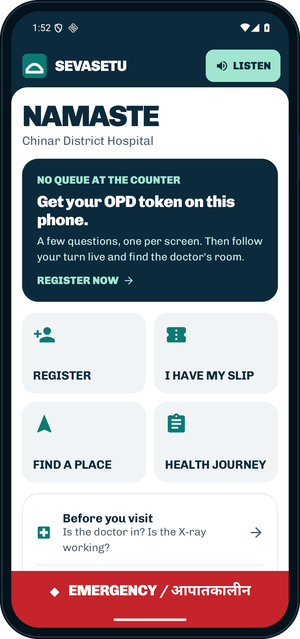
  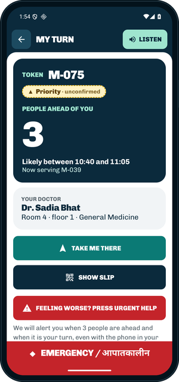
  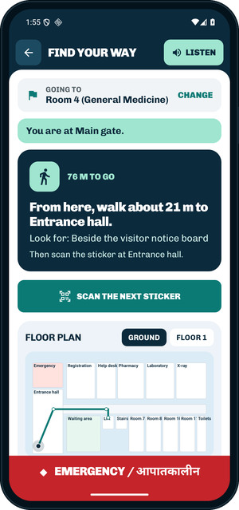
  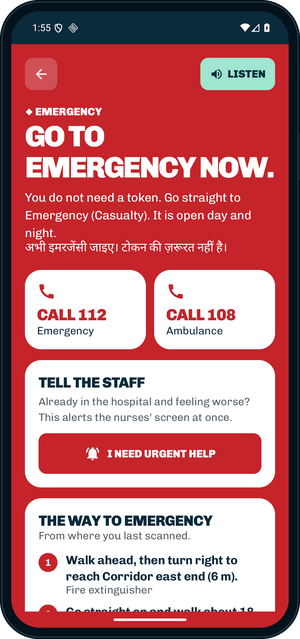
</p>

---

## Contents

1. [The problem](#the-problem)
2. [What SevaSetu does](#what-sevasetu-does)
3. [Try it in two minutes](#try-it-in-two-minutes)
4. [The patient app](#the-patient-app)
5. [The hospital dashboard](#the-hospital-dashboard)
6. [No smartphone? SMS and missed call](#no-smartphone-sms-and-missed-call)
7. [Help chat](#help-chat)
8. [Safety rules that never bend](#safety-rules-that-never-bend)
9. [How it fits together](#how-it-fits-together)
10. [Run it locally](#run-it-locally)
11. [Repository layout](#repository-layout)
12. [Tech stack](#tech-stack)
13. [Status and known limits](#status-and-known-limits)
14. [More documentation](#more-documentation)

---

## The problem

A visit to a district hospital OPD often looks like this:

- **Hours at the registration counter** before a token is even issued.
- **Crowded waiting halls** with no idea how long the wait will be, so nobody dares to step away.
- **Getting lost** in corridors looking for the right room, which is hardest for elderly patients and people who
  cannot use stairs.
- **No mobile signal** in many buildings and villages, so "just use an app" is not enough.
- **Lost continuity:** missed follow-ups go unnoticed, and the doctor sees each patient cold.

## What SevaSetu does

| For | What changes |
|---|---|
| **Patients** | Register on the phone in their own language, get a token, room and realistic time window, wait anywhere, get alerted when 3 people are ahead, and follow step-by-step directions to the room. |
| **Patients without data** | Text `SLIP`, `REG` or `HELP` to the hospital number, or give it a missed call. |
| **Triage nurses** | One screen with every queue, priority bands to confirm, and an alarm until someone responds to an urgent request. |
| **Counter staff** | Register walk-ins and print a QR slip that links to the same live queue. |
| **Doctors** | See who is next, the symptom note and past visits before the patient walks in; set the follow-up in one tap. |
| **District officers** | Load across all hospitals, tomorrow's forecast, load-balancing suggestions and an early outbreak signal. |

Everything runs on one shared backend, so a patient registering on the phone appears on the staff dashboard at once,
and a staff action reaches the patient's phone at once.

---

## Try it in two minutes

1. Open **https://sevasetu-self.vercel.app** (or run everything locally: [Run it locally](#run-it-locally)).
2. Click **Sign in**, then **tap a role**: no password needed. (Every demo account uses the password
   `sevasetu-demo` if you prefer to type: `triage@`, `counter@`, `doctor@`, `admin@` or `demo@sevasetu.demo`.)
3. On an Android phone, open https://sevasetu-self.vercel.app/patient-app, download and install the app (allow
   installs from your browser when Android asks), register yourself, and watch your token appear on the
   **Facility** screen. It works over mobile data from anywhere.
4. On the phone, press **Emergency** then **I need urgent help**: the Facility screen raises an alarm until a nurse
   taps **Seen**, and the phone shows that it was seen.
5. Open **Demo** to speed up the hospital clock or turn on autopilot, and watch your place in the queue move.

The demo starts at **10:30 AM** in a busy OPD: three hospitals (Chinar, Jhelum and Lidder), 15 doctors, about 100
patients waiting, and returning patients with a history of visits.

---

## The patient app

A native Android app (Kotlin, Jetpack Compose) in [`app/`](app/). Built for first-time smartphone users and
elderly patients: one question per screen, large type, read-aloud on every main screen.

<p>
  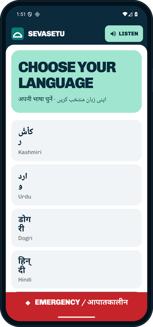
  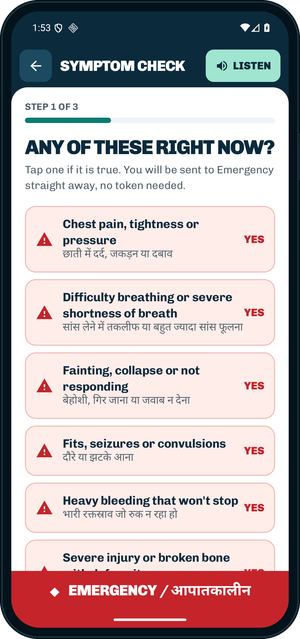
  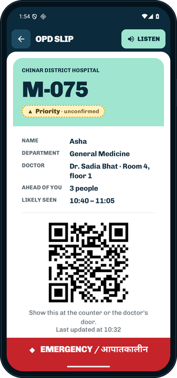
  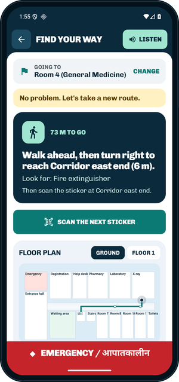
</p>

| Feature | What the patient gets |
|---|---|
| **Five languages** | Kashmiri, Urdu, Dogri, Hindi and English, each in its own script; right-to-left layout for Urdu and Kashmiri; **Listen** reads the screen aloud. |
| **Privacy first** | A first name is enough. No Aadhaar. Sharing anonymous movement in the building is optional and off by default. |
| **Registration** | One question per screen: who it is for, which hospital, name, age group, and any help needed (for example, difficulty walking). |
| **Warning signs first** | 11 red-flag questions come before anything else. Any "yes" ends the form and opens Emergency. No token, no waiting. |
| **Symptom check** | Suggests the right department and writes a short note for the doctor. It never diagnoses. |
| **OPD slip** | Token, doctor, room and a time window, with a QR code staff can scan. No health data on the slip. |
| **My Turn** | People ahead of you, live. A notification when 3 are left and when you are called, even with the phone in a pocket. Every change in your place comes with a reason. |
| **Find the room** | QR stickers in every corridor. Scan one and get step-by-step directions with turns, distances and landmarks, a floor plan, stair-free routes through the lift, and a new route after a wrong turn. |
| **Emergency** | On every screen. The way to Casualty from where you are, one-tap 112 and 108, and an urgent request nurses see at once, with confirmation when it has been seen. |
| **Works with no signal** | Registration, the symptom check, maps, directions and Emergency all work offline. Requests wait in an outbox and are sent the moment the phone reconnects, urgent ones first. |
| **I have my slip** | Registered at the counter? Scan the paper slip or type the token to follow it live. |
| **Health Journey** | Past visits and the next follow-up date. |
| **Before you visit** | Which doctors are in today and which services are working. |
| **Accessibility** | Four text sizes, high contrast, read-aloud, flash alerts for hearing needs. |

<p>
  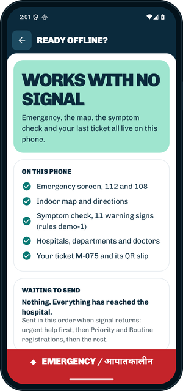
  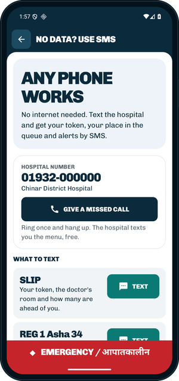
  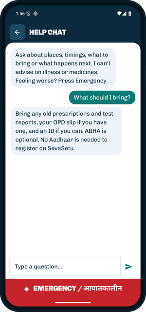
  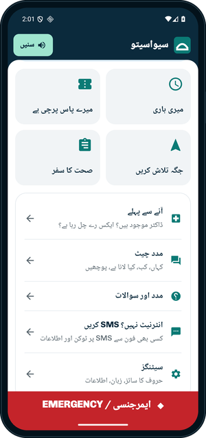
</p>

---

## The hospital dashboard

A Next.js website in [`web/`](web/), for hospital staff and district officers. Each role sees the screens it needs.

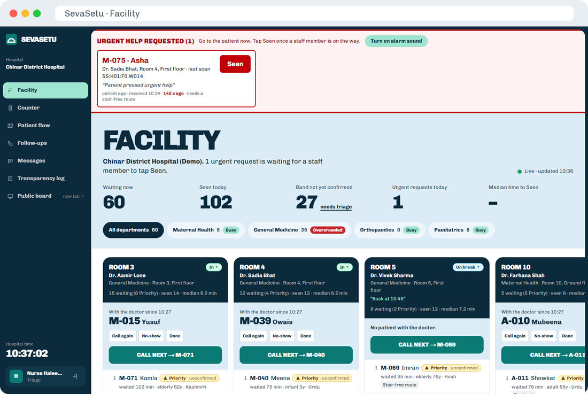

| Screen | Who | What it does | Path |
|---|---|---|---|
| **Landing page** | Everyone | What SevaSetu is, a walkthrough of a patient's first four minutes | `/` |
| **Facility** | Triage nurse | Every queue by room, priority bands to confirm, call next / no-show / done, urgent requests with an alarm until **Seen** | `/facility` |
| **Counter** | Counter staff | Register patients without a phone and print a QR slip | `/counter` |
| **My patients** | Doctor | The patient with you, who is next, the symptom note, Health Journey and the follow-up in one tap | `/doctor` |
| **Follow-ups** | Triage nurse | Missed and due follow-ups, with call, SMS reminder or community health worker actions | `/followups` |
| **Patient flow** | Admin | A live crowd map from anonymous sticker scans, with wrong-turn hotspots | `/flow` |
| **District overview** | District officer | All hospitals at once: load, tomorrow's forecast, load balancing, outbreak signal, impact | `/district` |
| **Messages** | Staff | Every SMS in and out, a test "basic phone", follow-up reminders, and what patients asked the help chat | `/messages` |
| **Transparency log** | Staff | Every change to the queue, with the reason the patient saw | `/log` |
| **Waiting-room board** | Public, no login | Large-screen board that calls tokens | `/board/H01` |
| **Get the app** | Public | Download the APK, a QR to scan, the help chat and SMS instructions | `/patient-app` |
| **Demo controls** | Demo operator | Hospital clock speed, autopilot, add patients, raise an urgent flag, reset | `/demo` |

<table>
  <tr>
    <td>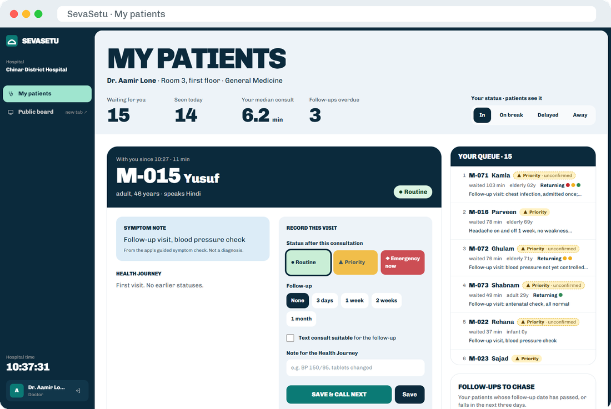</td>
    <td>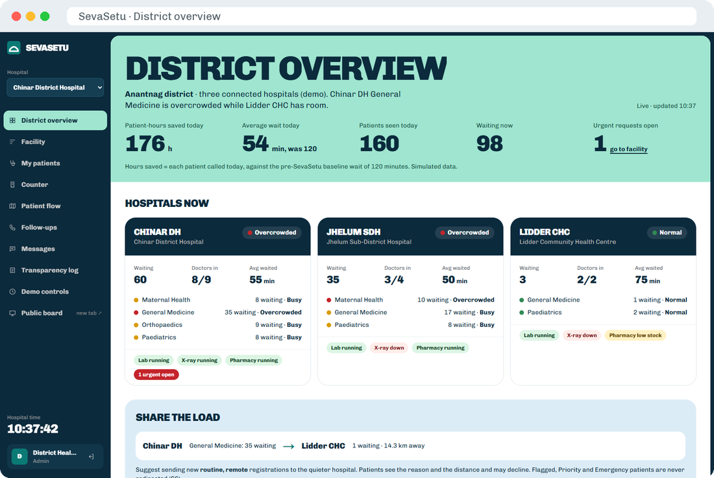</td>
  </tr>
  <tr>
    <td>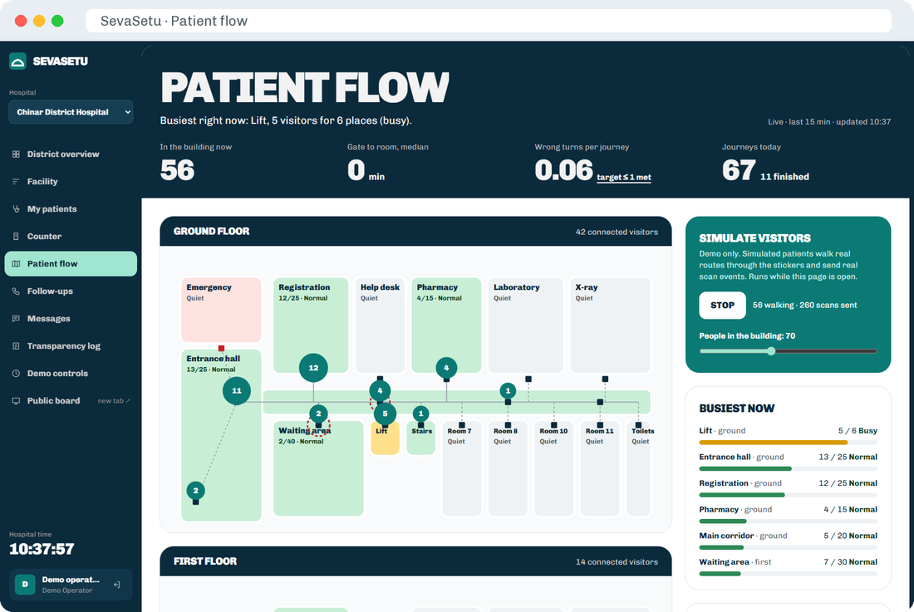</td>
    <td>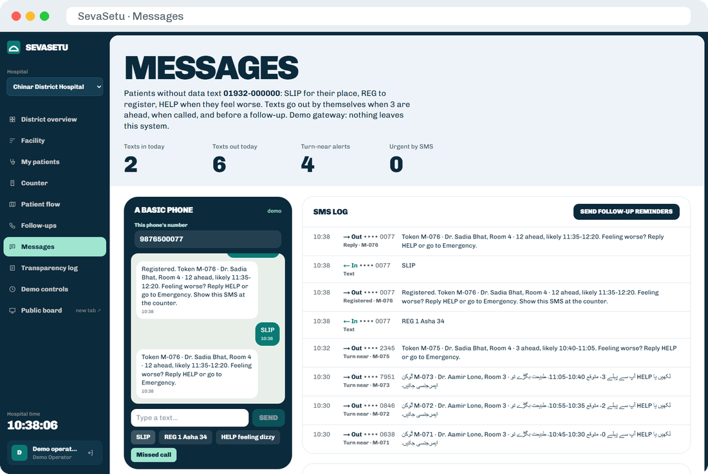</td>
  </tr>
  <tr>
    <td>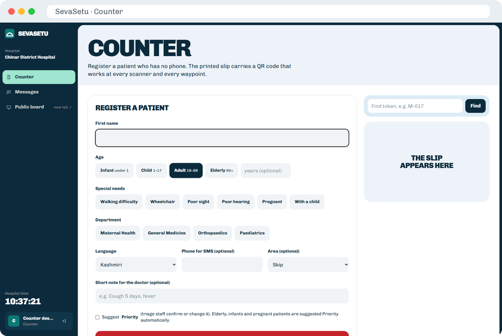</td>
    <td>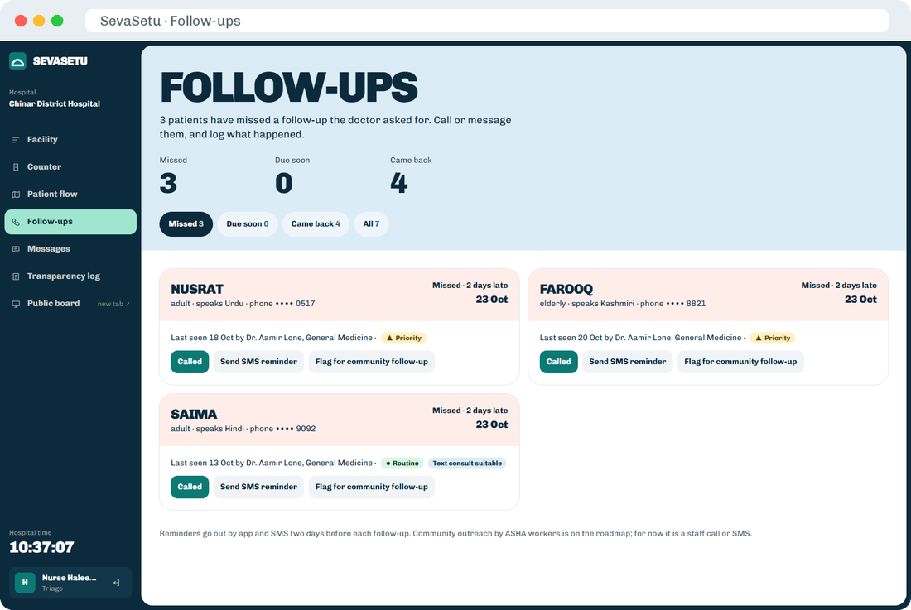</td>
  </tr>
</table>

---

## No smartphone? SMS and missed call

Any phone works. Patients text the hospital number:

| Text | Reply |
|---|---|
| `SLIP` or `STATUS` | Your token, the doctor's room and how many people are ahead of you |
| `REG <department number> <name> [age]`, for example `REG 1 Asha 34` | Registers you and texts back your token |
| `HELP <what is wrong>` | Raises an urgent request on the nurses' screen, with your words |
| Anything else | The menu, in Hindi, Urdu or English (detected from the script you write in) |
| **Missed call** | The menu by SMS, free |

The system also texts patients by itself: when 3 people are ahead, when they are called, if they are sent to
Emergency, and to remind them of a missed follow-up. Each alert is sent once per visit.

The demo uses a **mock SMS gateway**: messages are stored and shown on the **Messages** screen, where staff can also
play the part of a basic phone. A real gateway (an Indian SMS provider) plugs in at `sms_send` in
[`supabase/migrations/20261025000006_sms_chat.sql`](supabase/migrations/20261025000006_sms_chat.sql).

---

## Help chat

A chat in the app and on the `/patient-app` page that answers **where, when and what to bring**: live queue position,
which doctors are in, OPD timings, services, directions to a place, and 13 approved FAQs in English, Hindi and Urdu.

- It **never gives medical advice**. Questions about diagnosis or medicine are refused politely and sent to the
  help desk.
- **A warning sign ends the chat**: mention chest pain, breathlessness or another red flag and it sends you straight
  to Emergency.
- It is rule-based and runs in the database (`chat_ask`), so every answer is predictable and reviewable. Staff see
  what patients asked on the **Messages** screen.

---

## Safety rules that never bend

These are enforced by the **backend**, not just the screens, so no bug in the app or the website can break them.

1. **Emergencies are never queued.** Any warning sign goes straight to Emergency with no token.
2. **Nobody moves in the queue without a reason.** Every staff action needs a reason, the patient sees it, and it is
   written to the transparency log.
3. **A fairness guard** stops priority patients from pushing routine patients back indefinitely.
4. **No health data on the slip or in the QR code.** The QR carries only an ID.
5. **The app never diagnoses.** The symptom check suggests a department and a band; staff confirm the band.
6. **Honest states.** "Last updated" times on every live number, and the urgent request shows "seen" only when a
   staff member has actually tapped Seen.

The full checklist is in [`app/SAFETY_CHECKLIST.md`](app/SAFETY_CHECKLIST.md).

---

## How it fits together

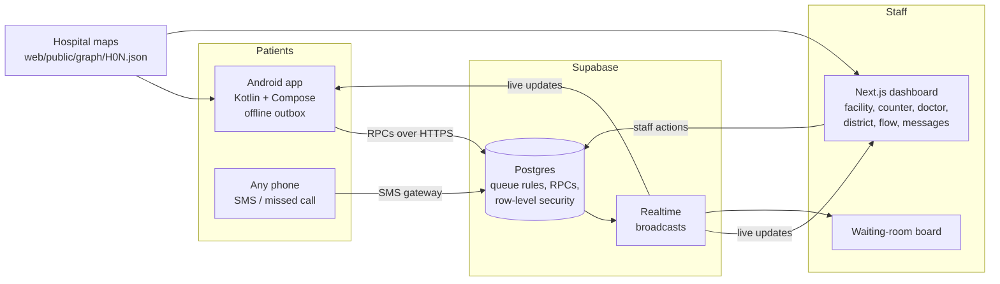

- **One backend, all the rules.** Queue ordering, token allocation, wait windows, urgent flags, the fairness guard,
  SMS commands and the help chat are Postgres functions in [`supabase/migrations/`](supabase/migrations/). Patients
  call them with the public key; staff screens are protected by row-level security and staff roles.
- **Live everywhere.** Supabase Realtime pushes changes to the app, the dashboard and the board.
- **Offline-first app.** The phone keeps its own copy of the maps, rules and last state in Room, and an outbox
  (WorkManager) sends requests when the signal returns: urgent first, then priority, then routine.
- **Indoor navigation without GPS.** Each hospital is a graph of QR waypoints, corridors, lifts and stairs, shared by
  the app and the website. Routing runs on the phone, so it works offline.

---

## Run it locally

### 1. The backend

Needs **Docker Desktop** and **Node 20+**.

```bash
npx supabase start          # first run downloads images, then applies migrations and the demo seed
npx supabase status         # shows the API URL and the ANON_KEY you need below
```

`npx supabase db reset` rebuilds the database and the 10:30 AM demo. If live updates stall after a reset, run
`docker restart supabase_realtime_sevasetu`.

### 2. The website

```bash
cd web
cp .env.example .env.local  # paste the ANON_KEY from `npx supabase status`
npm install
npm run dev                 # http://localhost:3000
```

### 3. The patient app (Android)

Needs the Android SDK and JDK 21 (Gradle downloads one if needed). Full guide: [`app/README.md`](app/README.md).

1. Create `app/local.properties` (it is git-ignored):
   ```properties
   sdk.dir=C\:\\Users\\<you>\\AppData\\Local\\Android\\Sdk
   sevasetu.supabaseUrl=http://127.0.0.1:54321
   sevasetu.supabaseAnonKey=<ANON_KEY>
   ```
2. Plug in the phone (USB debugging on) and run:
   ```bash
   cd app
   ./gradlew :androidApp:installDebug
   adb reverse tcp:54321 tcp:54321   # the phone reaches the laptop's backend through the cable
   ```
3. Home shows **Connected to the hospital**. With no URL set, the app runs on a built-in simulator instead.

To serve the APK from the website's **Get the app** page, copy
`app/androidApp/build/outputs/apk/debug/androidApp-debug.apk` to `web/public/download/sevasetu-patient.apk`.

### Tests

```bash
cd app && ./gradlew :androidApp:testDebugUnitTest   # routing, directions, translations
cd web && npm run lint && npx tsc --noEmit
```

---

## Deployment

The live demo runs on free tiers:

| Part | Where | How to update it |
|---|---|---|
| Backend | Supabase Cloud, Mumbai region (`ap-south-1`) | `npx supabase db push --linked` after adding a migration |
| Website | Vercel, project `sevasetu`, root folder `web/` | `cd web && npx vercel deploy --prod` |
| Android app | GitHub Releases, file `sevasetu-patient.apk` | Build with the cloud URL and key in `app/local.properties`, then upload to a new release |

The website reads `NEXT_PUBLIC_SUPABASE_URL`, `NEXT_PUBLIC_SUPABASE_ANON_KEY`, `NEXT_PUBLIC_DEFAULT_HOSPITAL` and
`NEXT_PUBLIC_APK_URL` from Vercel's environment settings. To restart the demo from 10:30 AM, sign in as
**Demo operator** and use **Reset** on the Demo screen. A free Supabase project pauses after a week without use:
open it in the Supabase dashboard to wake it.

---

## Repository layout

```
supabase/
  migrations/      all backend rules, in order:
    *_core.sql       schema, wait windows, allocation, ordering, fairness guard, patient RPCs, staff actions, RLS
    *_demo.sql       demo clock, seed generator, autopilot
    *_dashboard.sql  dashboard read models
    *_flow.sql       patient flow from anonymous scans
    *_roles.sql      Health Journey, follow-ups, doctor's desk, district overview, six weeks of history
    *_sms_chat.sql   SMS commands and alerts, missed call, help chat
  seed.sql         three demo hospitals, doctors, staff accounts
web/               Next.js staff dashboard and public pages
  src/app/(staff)/ facility, counter, doctor, followups, flow, district, messages, log, demo
  public/graph/    indoor maps of the three hospitals (shared with the app)
  scripts/         map builders: edit build_h0N_graph.py, run it, both copies update
app/               Android patient app (Kotlin, Jetpack Compose)
  androidApp/      the app module
  i18n/strings.py  every string in five languages; generates Strings.kt
docs/
  CONTRACT.md      exact request and response shapes between the app and the backend
  images/          screenshots used in this README
APP_README.md      guide to the backend rules for anyone building on the patient app
```

---

## Tech stack

| Part | Technology |
|---|---|
| Backend | Supabase: Postgres (PL/pgSQL functions, row-level security), Realtime, Auth |
| Staff website | Next.js 16, React 19, TypeScript, Tailwind CSS 4, Motion, supabase-js |
| Patient app | Kotlin, Jetpack Compose (Material 3), Room, WorkManager, CameraX + ML Kit barcode scanning, OkHttp, Android text-to-speech |
| Maps | JSON graphs of QR waypoints, built by Python scripts; Dijkstra routing in TypeScript and Kotlin |
| Type | Chivo, across the website and the app |

---

## Status and known limits

**Working end to end:** everything in the tables above, on the local backend, with the app on a real phone.

**Still open:**

- **App signing.** The downloadable APK is a debug build; a signed release build is needed for the Play Store.
- **Translations.** Hindi and Urdu are drafts that need a native speaker's review; Kashmiri and Dogri fall back to
  Urdu and Hindi for most text. See [`app/TRANSLATION_REVIEW.md`](app/TRANSLATION_REVIEW.md).
- **SMS** goes through a mock gateway; a real provider is needed for real phones.
- **ABHA** is a mocked field only.
- **Largest text size:** a few cards on the home screen still wrap badly at the largest setting.

Detailed status: [`app/FEATURES.md`](app/FEATURES.md). Design decisions: [`app/DECISIONS.md`](app/DECISIONS.md).

---

## More documentation

| Document | What is in it |
|---|---|
| [`app/README.md`](app/README.md) | Run, test and publish the patient app; every screen and the backend call behind it |
| [`APP_README.md`](APP_README.md) | The backend rules the app follows, screen by screen |
| [`docs/CONTRACT.md`](docs/CONTRACT.md) | Exact RPCs, enums, realtime channels, QR formats and the map format |
| [`app/FEATURES.md`](app/FEATURES.md) | What is done, partial and not built |
| [`app/SAFETY_CHECKLIST.md`](app/SAFETY_CHECKLIST.md) | Safety checks that must pass before a demo |
| `SevaSetu_PRD_v1_0_Complete.docx` | The full product requirements |

---

Built by **Byteclub** for **HackCache**.
